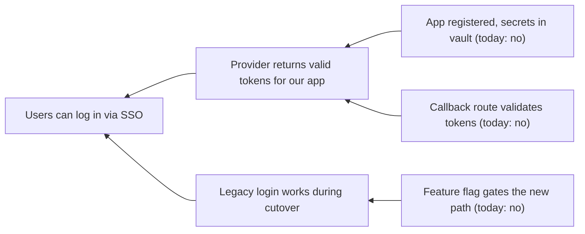

# Backward Planning

Forward task lists drift. This skill fixes the destination first, then derives the goals that must be true to reach it. The order of the four phases is the point.

## When to use

- "How do I get to X", "what would it take to ship Z", "plan this".
- Scoping a non-trivial feature, migration, launch, or research effort.
- A forward task list sprawls, or decisions feel arbitrary because "done" is undefined.

Skip for one-shot fixes and work where the action is the goal.

## Method

1. **Outcome.** 3–7 concrete bullets on the world after success: what people observe, what is measurably true, what pain is gone, who notices. If you cannot picture it sharply, ask the user before going on.
2. **Success criteria.** Each one observable by someone other than the implementer, binary or thresholded, and about the end state, not the work. Bad: "Refactored auth." Good: "No call site imports `legacy_auth.*`; p95 login ≤ 200ms."
3. **Precondition tree.** From each criterion, ask "what must be true just before this?" until you reach something true today. Nodes are **states, not verbs** ("tokens are validated", not "validate tokens"). Mark nodes that are true today and stop expanding there.
4. **Goals.** Each edge from a true-today leaf toward the root is a goal: **name** (outcome-shaped), **done when** (the state it produces), **depends on**, **roughly** (S/M/L and a one-line approach). Order by dependency and mark parallel branches.

## Output format

1. **Outcome** — the bullets.
2. **Success criteria** — a checkable list.
3. **Precondition tree** — mermaid if it branches, indented bullets if linear.
4. **Goals** — ordered, with the four fields. Mark independent branches `[parallel: A]`, `[parallel: B]`.

Keep each section tight. Implementation detail belongs in each goal's own plan.

## Anti-patterns to refuse

- **Skipping the outcome** ("let's just list tasks") — forward planning in disguise.
- **Verbs as nodes.** Rephrase as states.
- **Endless expansion.** Wrong altitude (zoom out) or an undefined outcome (go back to step 1).
- **Goal = outcome.** Find at least one non-trivial precondition.

## Quick mode

For ≤ half a day of work: a one-sentence outcome, 2–3 criteria, a linear precondition list, ordered goals without sizes. The outcome still comes first.
