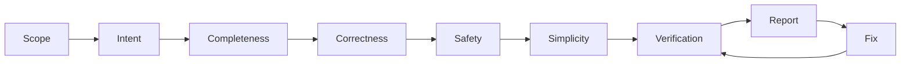

# Double Check

You know how to review code. This skill fixes the order of the passes, the rules of evidence, and the report. The goal is confidence, not a list of comments: at the end, the user knows what is verified, what is fixed, and what risk is left.

## Method

1. **Fix the scope.** Find the change: uncommitted diff, branch against its base, a commit, or a PR. Read the whole diff and every file it touches, not only the hunks.
2. **State the intent.** In 1–3 sentences, say what the change must do. Take it from the task, commit message, PR description, or issue. If you cannot state it, ask the user before reviewing. A review without intent can only find style issues.
3. **Run the five passes** below, in order. Use `references/checklist.md` for the questions of each pass.
   1. **Completeness.** List what the intent requires, then map each item to the diff. Search for what the diff did not touch but should have: other callers of a changed signature, the old name after a rename, sibling implementations, tests, docs, config, migrations, generated files.
   2. **Correctness.** Trace each changed path from its callers. Try edge inputs, error paths, and the behavior that existing callers relied on before the change.
   3. **Safety.** Check untrusted input, secrets, permissions, destructive or irreversible operations, persisted data and wire formats, concurrency, and what happens when a dependency fails. Ask how to roll it back.
   4. **Simplicity.** Look for a smaller change with the same effect: an existing helper, a removed branch, less speculative generality, fewer new concepts. Remove leftovers such as debug output, dead code, and commented-out code.
   5. **Verification.** Run the build, tests, linters, and type checks that cover the change. Exercise the changed behavior directly (a test, a script, the app). Confirm a suspected bug with a failing test or a repro before you report it as confirmed.
4. **Get an unanchored read** when the change is large or risky. Give a fresh subagent the diff and the intent, not your findings, and ask it for completeness and correctness issues. Verify what it returns before you use it.
5. **Report**, in the format below. Then fix what the user approves, or fix directly if they asked for fixes, and run pass 5 again on the result.

## Rules

- **Every finding has evidence.** A `file:line`, a command and its output, or a repro. Without evidence, a finding is a question, and the report says so.
- **Mark each finding as confirmed or suspected.** Confirmed means you ran something or traced the path to the end.
- **Stay inside the change.** Put problems that existed before the change in a separate short list. Do not fix them without permission.
- **Missing work counts as a finding.** An unchanged caller, a missing test, or a stale doc is a defect of the change, not a suggestion.
- **Simpler means fewer moving parts, not fewer lines.** Do not suggest a clever rewrite. Do not suggest an abstraction for one use.
- **Say what you did not check.** If you cannot run the tests, reach a service, or see a platform, write it under remaining risk. Do not hide it.
- **Do not inflate.** If the change is good, say so in one line. Do not add minor comments to fill the report.

## Output format

1. **Verdict.** One of: *ready*, *ready after fixes*, *not ready*. Add one sentence of reason.
2. **Intent.** The 1–3 sentences from step 2.
3. **Findings.** A table, most severe first: severity (blocker / should fix / nit), pass, `file:line`, the problem, the evidence, confirmed or suspected, and the proposed fix.
4. **Missing.** A checklist of the work that the change still needs.
5. **Simplifications.** Each with the before and after, in a few lines.
6. **Verification.** Each command that you ran, with its result. Each behavior that you exercised, with how.
7. **Remaining risk.** What you did not check, and why.
8. **Pre-existing issues.** Optional, short.

## Quick mode

For a small diff (one file, under about 30 lines): do passes 1, 2, and 5 only, and report the verdict, the findings, and the verification.
