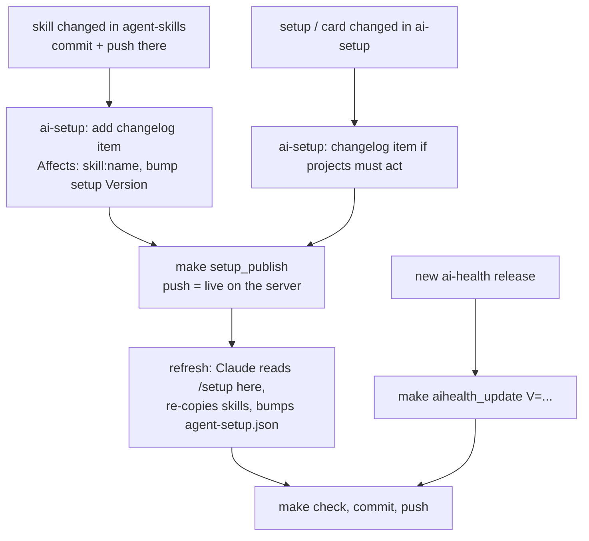

# external-sources

What in vps_ai comes from other repos, and the order to apply an update from each. `make externals` reports what is out of date and the next step.

The server updates itself from `main` (webhook pull, `hooks/post-merge`, GitHub Actions for Flutter), so a source is "deployed" once its change is on `main` — except ai-health, which lives in gitignored `.venv/` dirs and is never pulled.

| Source | Lands in | Gets there by |
|---|---|---|
| `ai-setup` (`../ai-setup`, `site/`) | `projects/landing/setup`, the manifest-listed files in `projects/landing/cards/` | `make setup_publish MSG=...` → ai-setup's `make publish`: commits only manifest files, pushes `main` |
| `ai-setup` (as consumer) | `.claude/agent-setup.json`, `CLAUDE.md` wording, `cards/standing-defaults.md` | a setup refresh: ask Claude here to read `https://ai.memention.net/setup` and apply it (update mode) |
| `agent-skills` (`../agent-skills`) | `.claude/skills/*` | copied by the setup refresh; never edit the copies here |
| `ai-health` (`epatel/ai-health`) | `.venv/` locally and on the server | `make aihealth_update V=vX.Y.Z`: re-pins `CLAUDE.md`/`README.md`, reinstalls both venvs |

## Update order

- Publish before refreshing: the refresh reads the *live* `/setup` and changelog, so an unpublished change is invisible to it.
- A skill change with no `Affects: skill:<name>` changelog item is never picked up by a refresh; `make externals` still lists the skill as differing.
- `make setup_publish` passes `VPS=$(CURDIR)` because ai-setup's Makefile uses `VPS` for the path to this checkout, while this repo's Makefile uses it for the ssh target.
- A new aihealth version can shift scores; record the new pin in `project-plan.md` Decisions.
