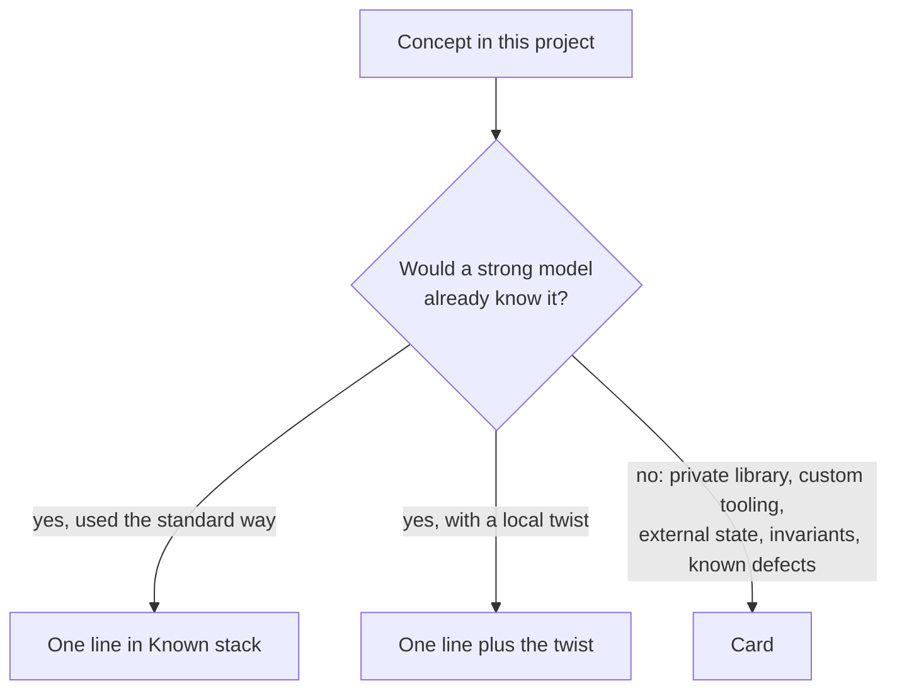

# Known Stack ⚗️

## Problem

A coding model already knows the mainstream frameworks, libraries and design patterns in depth: Flutter, Rails, React, go_router, provider, the State pattern, singletons, barrel files, a popular backend SDK. A full card procedure still writes an architecture card and domain cards that re-describe them. That costs context in every session that opens them, and it invites drift: the card says one thing, the model's prior says another, the code says a third.

Leaving them out entirely is not free either. Without a hint, the agent spends turns reading files to rediscover where routes live or how dialogs are shaped.

## Solution

**Name** each standard concept in one line in `CLAUDE.md`, with the project's local twist if it has one. **Card** only what neither the code nor the model's prior can supply.



A **Known stack** section goes in `CLAUDE.md` between the overview and the commands:

```markdown
## Known stack — use what you already know

These are standard and used the standard way. There are no cards for them: read the code
and apply the usual idioms.

- **Flutter + Material 3**, `StatefulWidget` + `setState` for page state.
- **go_router**: all routes are in `lib/app/router.dart`; pages get their dependencies as constructor args there.
- **provider**: one `ChangeNotifierProvider` at the root (`lib/app/app.dart`).
- **Coordinator = State pattern / event bus**: events are `CoordinatorEvent` subclasses, dispatched with
  `context.handle(event)`. Scaffolding only; no page dispatches events yet.
- **Barrel imports**: every file imports only `package:app/imports.dart`. Add a new file to its folder's barrel.
- **Dialogs**: each dialog has a `static Future<void> show({context, …})`; the caller does the database work.
```

Each line names the concept the model already has, then gives the *where* (file paths) and the *twist* (unused, deviates from the default, one fixed location). Skip a line that would only say "we use X" with nothing a reader could act on, unless it disambiguates (which state library, which router).

## What still gets a card

- Private or unpublished libraries and DSLs, such as the team's own widget extension package.
- Custom build or deploy tooling: sed toggles, generated files, unusual Makefile flows.
- State that lives outside the repo: server-side schemas, collection layouts, external invariants.
- Invariants and failure modes the code does not make obvious ("remove deletes every language").
- Known current defects an agent will otherwise trip over.
- A bespoke topology. Keep the architecture card when the system is *not* a textbook instance of its stack.

## Evidence

One A/B test, on a 700-line Flutter + PocketBase app (Sonnet 5.5, 3 tasks × 4 doc conditions × 3 runs). Compared with the full card set (12 cards, 35 KB), the Known stack lines plus 3 specialized cards (10 KB) used 4.9 turns per task instead of 7.6, cost about half as much, and scored higher with a blind judge (7.4 vs 6.8 out of 10). The same 3 cards without the Known stack lines scored about the same but took 8.2 turns. No docs at all scored lowest (6.2). The model followed the project's conventions in every condition: the docs changed how fast it got there, not whether.

The specialized cards gave the quality gains: a parameterized-filter rule used only by carded runs, and a build-toggle defect missed without docs. The sample is small, and the repo and model are single. Treat the pattern as experimental.

## Rules of thumb

- **Keep it short.** Aim for 5–15 lines. If an entry needs a paragraph, it is not standard: make it a card.
- **Graduate on evidence.** If agents keep getting a "known" concept wrong in a project-specific way, move it from a line to a card. If a card only restates the framework's documentation, demote it to a line.
- **Paths beat prose.** "All routes in `router.dart`" saves more exploration than a description of how go_router works.
- **Say when it is unused.** Scaffolding that looks live (an unused event bus, a dead service) is a twist worth one line.
- **No version trivia** unless it changes the API the agent should write against.

## When to apply

Any project built mostly from mainstream frameworks and patterns used in their standard way. Apply it before the Context Cards procedure. That procedure then skips the architecture card when the architecture is a textbook instance of the named stack, writes no domain cards for layers the Known stack lines cover, and spends its effort on the "What still gets a card" list. The pattern adds little to a project whose architecture is mostly bespoke.
